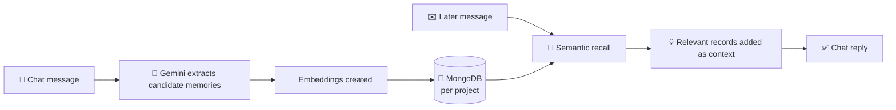

<div align="center">


<a href="https://github.com/">
  
</a>

<br/>


<br/>

### 📦 Download the project

<a href="https://drive.google.com/file/d/1GYomszrDDpFcWEN01dk8BYEEVZls_ojG/view?usp=sharing">
  
</a>

<sub>Opens in Google Drive · download, extract, then follow the setup below</sub>

</div>

<br/>


## ✨ Overview

**Smaran.ai** is a workspace-based chat app with persistent project memory. It extracts useful facts from conversations, retrieves relevant memories for later replies, and helps resolve conflicting information.

## 🧠 Features

| | Feature | What it does |
| :-: | --- | --- |
| 💬 | **Workspace chat** | Separate sessions inside each workspace |
| 🎚️ | **Memory control** | Turn memory on or off per workspace |
| 🗂️ | **Typed records** | Decisions, assumptions and more |
| 🔍 | **Memory views** | All records, records used in a reply, status, source quote and activity timeline |
| 🧭 | **Semantic recall** | Finds the right memory by meaning, not keywords |
| 🔄 | **Conflict handling** | A newer choice can supersede an older assumption |

## 🔬 How memory works



When memory is enabled, the server keeps the last 20 turns for each user, project, and session in Redis for 24 hours. Chat exchanges are not written to MongoDB `messages`, and assistant replies are never sent to memory extraction or embedding. Each reply can use recent Redis turns and up to five relevant long-term facts from MongoDB Atlas Vector Search. The extractor stores only non-secret, non-duplicate decisions, assumptions, constraints, or outcomes whose confidence meets `IMPORTANCE_MIN_CONFIDENCE` (default 0.7). Redis also caches embeddings by text hash and project recall results for 60 seconds. Redis failures do not prevent chat or long-term memory from working.

Create the Atlas Vector Search index before using long-term recall:

```powershell
npm run memory:index
```

The single Atlas index is `memory_index` on `memories`. It uses cosine similarity over `embedding`, dimensions from `EMBEDDING_DIMS`, and filter fields `userId`, `projectId`, `status`, and `type`. The configured Gemini model is `gemini-embedding-001` with 768 dimensions. `npm run setup` and `npm run memory:index` both wait until the index is queryable; setup also removes the obsolete `memory_vector` index after the replacement is ready.

For existing memory documents, run `npm run memory:backfill-embedding-model` once after setup. It fills missing `embeddingModel` metadata and reports documents whose stored vector length differs from `EMBEDDING_DIMS`. It does not re-embed those vectors; investigate mismatches before relying on their vector recall.

For local development, set `REDIS_URL` (default `redis://localhost:6379`). Docker Compose starts Redis and sets the container URL automatically. `SHORT_TERM_TTL_SECONDS`, `SHORT_TERM_TURN_LIMIT`, `IMPORTANCE_MIN_CONFIDENCE`, `EMBEDDING_CACHE_TTL_SECONDS`, `RECALL_CACHE_TTL_SECONDS`, and `MEMORY_DUPLICATE_THRESHOLD` default to 86400, 20, 0.7, 86400, 60, and 0.92.

The backend uses MongoDB. Configure a MongoDB connection string and a Gemini API key before starting the server.

## 📋 Requirements

- 🐳 Docker Desktop with Docker Compose, **or** Node.js 20 or later
- 🍃 A reachable MongoDB database. The Compose file does not start a MongoDB container; it uses the external database specified by `MONGODB_URI`
- 🔑 A Gemini API key in `GEMINI_API_KEYS` for memory embeddings

---

## 🚀 Getting started

### 1 · Get the project

> [!TIP]
> **[👉 Click here for the zip file](https://drive.google.com/file/d/1GYomszrDDpFcWEN01dk8BYEEVZls_ojG/view?usp=sharing)** — download, extract, and `cd` into the folder.

Or clone the repository:

```bash
git clone <repository-url>
cd <repository-directory>
```

Replace `<repository-url>` with the Git URL for this project and `<repository-directory>` with the folder created by `git clone`.

### 2 · Configure environment

Copy `.env.example` to `.env`, then set at least:

```env
MONGODB_URI=your-mongodb-connection-string
DB_NAME=smaran
JWT_SECRET=a-random-secret-at-least-32-characters-long
GEMINI_API_KEYS=your-gemini-api-key
```

> [!IMPORTANT]
> `JWT_SECRET` must be at least 32 characters. Never commit `.env` or put API keys in frontend code.

For MongoDB Atlas, make sure the cluster is running, the database user has access, and your machine's IP address is on the Atlas network access list. `APP_URL_DOCKER` sets the URL used to create invite links in Docker; set it to your public app URL when hosting remotely.

### 3 · Start with Docker Compose

Run these commands from the project directory:

```powershell
docker compose config --quiet
$env:HOST_PORT = "3003"
docker compose up --build -d
docker compose ps
docker compose logs -f smaran-ai
```

Open **[http://localhost:3003](http://localhost:3003)**. Check the database-backed health endpoint with:

```powershell
curl.exe http://localhost:3003/api/health
```

Stop the app with `docker compose down`. The database is external, so this does not delete MongoDB data.

The app listens on port 3001 inside the container and is published on host port 3003. If 3003 is already in use, choose another free port:

```powershell
$env:HOST_PORT = "3004"
docker compose up --build -d
```

Then open [http://localhost:3004](http://localhost:3004). To clear the override in the same PowerShell window, run `Remove-Item Env:HOST_PORT`.

---

## 🛠️ Run for local development

Open two PowerShell terminals in the project directory. Install both dependency sets once:

```powershell
npm ci
npm --prefix web ci
```

**Terminal 1 — API**

```powershell
npm run dev
```

**Terminal 2 — Vite frontend**

```powershell
npm run dev:web
```

Open **[http://localhost:5173](http://localhost:5173)**. The API listens on port 3001. Make sure `.env` has valid database and Gemini settings before starting.

## 🧰 Useful commands

| Command | Purpose |
| --- | --- |
| `docker compose config --quiet` | Validate the Compose file and variable interpolation |
| `docker compose up --build -d` | Build and start the container in the background |
| `docker compose logs -f smaran-ai` | Follow application logs |
| `docker compose ps` | Show container and health status |
| `docker compose down` | Stop and remove the container and network |
| `npm run setup` | Set up MongoDB collections and the vector search index |
| `npm run memory:index` | Create the `memory_index` Atlas Vector Search index |
| `npm run memory:backfill-embedding-model` | Backfill embedding metadata and report vector dimension mismatches |
| `npm run migrate:team` | Migrate legacy single-user memories to team projects |
| `npm run seed` | Seed demo memories |
| `npm run smoke` | Run a vector search smoke check |
| `npm run build:web` | Build the production frontend |

## 🩺 Troubleshooting

<details>
<summary><b>Port 3003 is already in use</b></summary>
<br/>
Docker publishes on host port 3003 by default. Use another free <code>HOST_PORT</code> such as 3004.
</details>

<details>
<summary><b><code>/api/health</code> returns 503</b></summary>
<br/>
Check MongoDB connectivity, credentials, Atlas network access, and the database name.
</details>

<details>
<summary><b>Gemini 401 errors during extraction or recall</b></summary>
<br/>
Replace <code>GEMINI_API_KEYS</code> with a valid Gemini API key, then recreate/restart the container.
</details>

<details>
<summary><b><code>exec ./docker-entrypoint.sh: no such file or directory</code></b></summary>
<br/>
Make sure shell scripts use LF line endings, then rebuild with <code>docker compose up --build -d</code>. <code>.gitattributes</code> now enforces LF for <code>.sh</code> files.
</details>

<br/>

<div align="center">

<a href="https://drive.google.com/file/d/1GYomszrDDpFcWEN01dk8BYEEVZls_ojG/view?usp=sharing">
  
</a>


</div>
